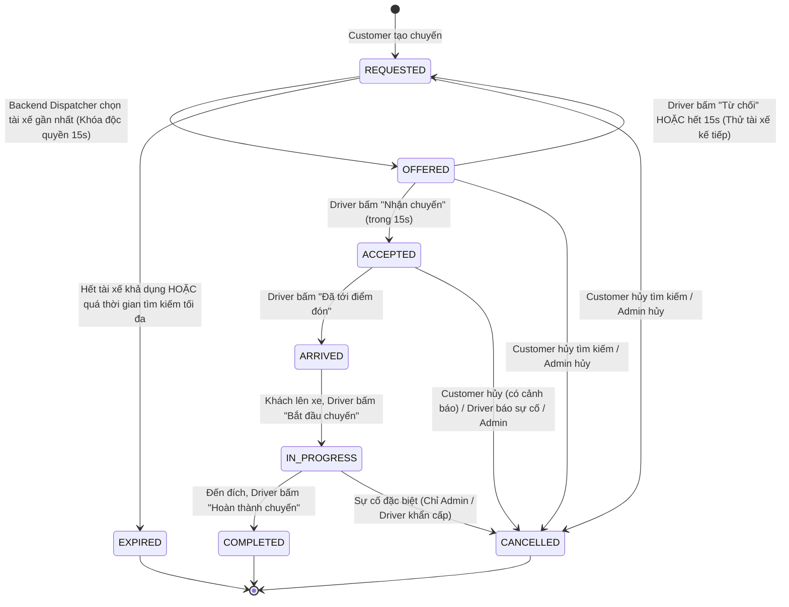

# GORIDE — BÁO CÁO AUDIT DB-01 VÀ THIẾT KẾ TRIP LIFECYCLE (GATE C.0)

- **Workspace:** `D:\Nam2_ky1\newDSA\RIDE-RTREE`
- **Phiên bản:** Gate C.0 Audit & Architecture Specification
- **Trạng thái:** HOÀN THÀNH AUDIT & THIẾT KẾ — DỪNG LẠI CHỜ PHÊ DUYỆT (CHƯA SỬA CODE, CHƯA SỬA DATABASE)
- **Ranh giới an toàn:** Tuyệt đối không can thiệp thư mục `D:\Nam2_ky1\BTL_DSA`. Giữ nguyên 100% C++ source code, database và thuật toán định tuyến.

---

## 1. NGUYÊN NHÂN GỐC CỦA LỖI DB-01 & BẰNG CHỨNG SOURCE CODE

### 1.1. Hiện trạng hàm `Database::resolve_database_path()`
Trong [`backend/src/database.cpp`](file:///D:/Nam2_ky1/newDSA/RIDE-RTREE/backend/src/database.cpp#L268-L291), thuật toán giải quyết đường dẫn database hiện tại như sau:

```cpp
std::string Database::resolve_database_path(const std::string& preferred_path) {
    if (preferred_path == ":memory:") return ":memory:";

    if (const char* env_p = std::getenv("GORIDE_DB")) {
        if (std::string(env_p).size() > 0) return std::string(env_p);
    }

    std::vector<std::string> candidates = {
        preferred_path,
        "database/goride.db",
        "../database/goride.db",
        "../../database/goride.db",
        "data/goride.db"
    };

    for (const auto& cand : candidates) {
        if (cand.empty()) continue;
        if (std::filesystem::exists(cand)) {
            return cand;
        }
    }

    return preferred_path;
}
```

### 1.2. Phân tích 7 câu hỏi trọng tâm về DB-01

1. **Thứ tự các đường dẫn được thử (Order of candidate paths):**
   - Ưu tiên 1: Chuỗi đặc biệt `":memory:"` (trả về ngay lập tức).
   - Ưu tiên 2: Biến môi trường `GORIDE_DB` nếu có giá trị.
   - Ưu tiên 3: Lần lượt quét mảng `candidates`:
     - `candidates[0] = preferred_path` (đường dẫn caller truyền vào)
     - `candidates[1] = "database/goride.db"` (đường dẫn tương đối từ workspace root)
     - `candidates[2] = "../database/goride.db"` (đường dẫn tương đối từ `build/`)
     - `candidates[3] = "../../database/goride.db"` (đường dẫn tương đối từ `build/bin/`)
     - `candidates[4] = "data/goride.db"` (đường dẫn dự phòng trong thư mục data)
   - Cơ chế chọn: Duyệt từ trên xuống dưới, candidate nào **đang tồn tại trên đĩa** (`std::filesystem::exists == true`) đầu tiên thì **lập tức return ngay candidate đó**.
   - Nếu không có candidate nào tồn tại: Trả về `preferred_path`.

2. **Ý nghĩa của `preferred_path`:**
   - Người gọi hàm (caller) truyền `preferred_path` với kỳ vọng rằng: "Hãy mở hoặc tạo mới database tại đường dẫn này".
   - Tuy nhiên, logic hiện tại chỉ tôn trọng `preferred_path` khi:
     - Hoặc file đó **đã tồn tại từ trước**.
     - Hoặc trong toàn bộ workspace **chưa có bất kỳ database sản xuất nào** tồn tại (`database/goride.db` không tồn tại).
   - Nếu caller muốn tạo một database mới riêng biệt (chưa tồn tại trên đĩa), `preferred_path` hoàn toàn bị tước quyền ưu tiên.

3. **Hành vi khi `preferred_path` chưa tồn tại (Kịch bản lỗi DB-01):**
   - Giả sử caller là một unit test muốn tạo database cô lập: `db.open("test_isolated.db")`.
   - File `"test_isolated.db"` chưa tồn tại -> `exists("test_isolated.db")` trả về `false`.
   - Vòng lặp duyệt sang candidate kế tiếp: `"database/goride.db"`.
   - Nếu trước đó máy chủ đã chạy và file `"database/goride.db"` đã tồn tại trên đĩa -> `exists("database/goride.db")` trả về `true`!
   - Hàm `resolve_database_path()` lập tức **trả về `"database/goride.db"`**!
   - Kết quả: Unit test mở nhầm và ghi dữ liệu thẳng vào database sản xuất thật!

4. **Hành vi khi nhiều database candidate cùng tồn tại:**
   - Nếu cả `"database/goride.db"`, `"../database/goride.db"` và `"../../database/goride.db"` đều tồn tại (ví dụ do quá trình build, test ở các thư mục con khác nhau sinh ra), hàm sẽ chọn candidate xuất hiện sớm nhất trong mảng.
   - Hành vi này mang tính bất định (nondeterministic): Tùy thuộc vào thư mục hiện hành (Current Working Directory - CWD) khi chạy lệnh, backend có thể kết nối vào các file database khác nhau mà không hề có cảnh báo.

5. **Hành vi khi không thể tạo hoặc mở database:**
   - Trong [`Database::open()`](file:///D:/Nam2_ky1/newDSA/RIDE-RTREE/backend/src/database.cpp#L293-L314):
     - Hàm gọi `ensure_parent_directory(path_)` để tạo thư mục cha.
     - Mở database với cờ `SQLITE_OPEN_READWRITE | SQLITE_OPEN_CREATE | SQLITE_OPEN_FULLMUTEX`.
     - Nếu mở thất bại: Ghi log ra `std::cerr`, giải phóng handle `db_ = nullptr` và trả về `false` (no-throw).
   - Trong [`AuthService::AuthService()`](file:///D:/Nam2_ky1/newDSA/RIDE-RTREE/backend/src/auth_service.cpp#L97-L120):
     - Gọi `db_.open(db_path_)` nhưng **hoàn toàn bỏ qua giá trị trả về boolean**.
     - Nếu mở thất bại, `db_.initialize_schema()` tiếp tục được gọi và âm thầm thất bại. `AuthService` chạy trong trạng thái không có database mà không ném lỗi ra ngoài.

6. **Có nguy cơ test ghi vào database thật không?**
   - **CÓ RỦI RO CỰC KỲ CAO (CRITICAL RISK).**
   - Bằng chứng 1: Xem phân tích ở Mục 3, mọi test truyền tên file test mới đều bị chuyển hướng vào database thật nếu file database thật đang tồn tại.
   - Bằng chứng 2 (Tìm thấy trực tiếp trong mã nguồn): Trong [`tests/test_auth.cpp`](file:///D:/Nam2_ky1/newDSA/RIDE-RTREE/tests/test_auth.cpp#L212-L216):
     ```cpp
     const std::string temp_db = "test_isolated_users_temp.json";
     AuthService auth_p(temp_db);
     ```
     Tại [`backend/src/auth_service.cpp`](file:///D:/Nam2_ky1/newDSA/RIDE-RTREE/backend/src/auth_service.cpp#L103-L107):
     ```cpp
     else if (db_path_.find(".json") != std::string::npos) {
         legacy_json_path_ = db_path_;
         db_path_ = "database/goride.db"; // <--- CỐ TÌNH ĐỔI SANG DATABASE THẬT!
     }
     ```
     Mã nguồn hiện tại cố tình ép mọi đường dẫn có đuôi `.json` thành `"database/goride.db"`, khiến test persistence trong `test_auth.cpp` chèn thẳng tài khoản test `persist.driver@demo.com` vào database thật!

7. **Có tạo database mới ngoài workspace dự kiến không?**
   - Nếu caller truyền đường dẫn tương đối (ví dụ chạy binary từ `build/bin/` và truyền `database/goride.db`), hàm `ensure_parent_directory` sẽ tạo thư mục `build/bin/database/` và sinh database tại đó nếu candidates trước đó chưa tồn tại.
   - Điều này làm phân tán các file database rác vào các thư mục build thay vì tập trung tại thư mục quy ước `database/` của workspace.

---

## 2. AUDIT MÔI TRƯỜNG BUILD SQLITE

### 2.1. Phân loại mức độ xác thực

| Hạng mục | Nguồn thông tin | Tình trạng xác thực | Chi tiết kỹ thuật |
| :--- | :--- | :--- | :--- |
| **C ABI Header Fallback** | [`backend/include/db/sqlite3.h`](file:///D:/Nam2_ky1/newDSA/RIDE-RTREE/backend/include/db/sqlite3.h) | **XÁC NHẬN BẰNG SOURCE (SOURCE VERIFIED)** | Chứa đầy đủ khai báo kiểu `sqlite3`, `sqlite3_stmt`, mã lỗi, cờ open và các hàm chuẩn C ABI (`sqlite3_open_v2`, `sqlite3_prepare_v2`, `sqlite3_step`, `sqlite3_bind_*`, `sqlite3_column_*`). Hoàn toàn tự chủ nếu thiếu header hệ thống. |
| **Logic CMake Tìm Thư Viện** | [`CMakeLists.txt`](file:///D:/Nam2_ky1/newDSA/RIDE-RTREE/CMakeLists.txt#L29-L60) | **XÁC NHẬN BẰNG SOURCE (SOURCE VERIFIED)** | Thử theo thứ tự: (1) `find_package(SQLite3)`, (2) MinGW64 include/lib tại `C:/msys64/mingw64`, (3) Windows native `winsqlite3.dll` trong `System32`, (4) `-lsqlite3`. |
| **Liên kết thực tế với `winsqlite3.dll`** | MinGW GCC Linker | **DỰ KIẾN LÝ THUYẾT (THEORETICAL)** | `winsqlite3.dll` có sẵn trên Windows 10/11. GNU ld hỗ trợ link trực tiếp DLL, nhưng cần compiler chạy thực tế để xác minh không thiếu import symbol. |
| **Thực thi lệnh shell / build** | Terminal Command | **BLOCKED (SANDBOX RESTRICTION)** | Lệnh shell trả về `Access is denied`. Không có quyền thực thi trình biên dịch trong môi trường hiện tại. |

> [!NOTE]
> Không tự cài thêm package hay tải binary lạ vào máy. Toàn bộ kiến trúc build C++ đã sẵn sàng cho cả hai trường hợp: có gói `mingw-w64-x86_64-sqlite3` chính quy hoặc dùng trực tiếp `winsqlite3.dll` của Windows.

---

## 3. THIẾT KẾ TRIP LIFECYCLE (CHỐT KIẾN TRÚC TOÀN HỆ THỐNG)

### 3.1. Các nguyên tắc bắt buộc đã chốt
1. **Dữ liệu duy nhất (Single Source of Truth):** Khách hàng, Tài xế và Quản trị viên (Admin) cùng đọc/ghi trạng thái chuyến từ database SQLite thông qua REST API chung.
2. **Cơ chế Polling:** Khách và Tài xế polling mỗi 2–3 giây để cập nhật trạng thái.
3. **Dispatch độc quyền có thời hạn (15s Exclusive Offer):**
   - Tại một thời điểm, một chuyến chỉ được giữ độc quyền cho **1 tài xế gần nhất, đang ONLINE và đủ điều kiện**.
   - Thời gian chờ tài xế phản hồi là **chính xác 15 giây**.
   - Nếu tài xế từ chối (REJECT) hoặc hết 15 giây (EXPIRED) mà không nhận: Hệ thống ghi nhận và chuyển offer cho tài xế đủ điều kiện tiếp theo.
4. **Không tự động hoàn thành chuyến:** Tài xế phải là người chủ động bấm xác nhận các mốc: Nhận chuyến -> Đã đến điểm đón -> Bắt đầu chuyến -> Hoàn thành chuyến.
5. **Cước phí & Lộ trình cố định:** Lưu cố định quãng đường và giá cước tính toán tại thời điểm tạo chuyến, không tự ý thay đổi trong suốt vòng đời chuyến đi.
6. **Minh bạch tuyệt đối:** Tách biệt hoàn toàn luồng demo mô phỏng ở frontend khỏi luồng dispatch thật của backend.

---

### 3.2. Máy trạng thái chuyến xe (State Machine Specification)



### 3.3. Ma trận chuyển trạng thái & Phân quyền hành động

| Trạng thái hiện tại | Trạng thái mới | Vai trò được phép | Điều kiện kiểm tra (Guards) & Xử lý |
| :--- | :--- | :--- | :--- |
| `[Khởi tạo]` | `REQUESTED` | `customer` | Khách đã đăng nhập, tọa độ đón/trả hợp lệ, không có chuyến khác đang dang dở. |
| `REQUESTED` | `OFFERED` | `system` (Backend) | Tìm thấy tài xế gần nhất có `approval_status = 'APPROVED'`, `online_status = 'ONLINE'`, `is_online = 1`, chưa từng từ chối chuyến này. Thiết lập `offer_expires_at = now + 15`. |
| `OFFERED` | `ACCEPTED` | `driver` | `user_id == current_offered_to`, thời gian hiện tại $\le$ `offer_expires_at`. Chuyển trạng thái tài xế sang `BUSY`. Gán `driver_id`. |
| `OFFERED` | `REQUESTED` | `driver` hoặc `system` | Tài xế bấm từ chối HOẶC thời gian hiện tại $>$ `offer_expires_at`. Ghi nhận tài xế vào bảng `trip_offers` với trạng thái `REJECTED`/`EXPIRED`. Xóa `current_offered_to`. |
| `REQUESTED` | `EXPIRED` | `system` | Không còn tài xế nào khả dụng trong bán kính phục vụ hoặc tổng thời gian tìm kiếm vượt quá ngưỡng (ví dụ 60 giây). |
| `REQUESTED` / `OFFERED` | `CANCELLED` | `customer` hoặc `admin` | Khách chủ động hủy khi chưa có xe nhận, hoặc Admin can thiệp. Giải phóng trạng thái tài xế (nếu đang offered). |
| `ACCEPTED` | `ARRIVED` | `driver` | `driver_id == user_id`. Ghi nhận mốc thời gian `arrived_at`. |
| `ACCEPTED` | `CANCELLED` | `customer`, `driver`, `admin` | Phải cung cấp lý do hủy (`cancel_reason`). Đặt lại tài xế về `ONLINE`. |
| `ARRIVED` | `IN_PROGRESS`| `driver` | `driver_id == user_id`. Khách đã có mặt trên xe. Ghi nhận `started_at`. |
| `IN_PROGRESS`| `COMPLETED`  | `driver` | `driver_id == user_id`. Đã đến điểm trả. Ghi nhận `completed_at`. Đặt lại tài xế về `ONLINE`. |
| `IN_PROGRESS`| `CANCELLED`  | `admin` (hoặc `driver`) | Chỉ cho phép khi có sự cố bất khả kháng. |

---

### 3.4. Đề xuất Schema Database hoàn chỉnh

Để hỗ trợ dispatch độc quyền 15s và không lặp lại tài xế đã từ chối, thiết kế bổ sung bảng `trip_offers` và cập nhật bảng `trips`:

```sql
-- Cập nhật bảng trips
CREATE TABLE IF NOT EXISTS trips (
    id                  TEXT PRIMARY KEY,
    customer_id         TEXT NOT NULL REFERENCES users(id),
    driver_id           TEXT REFERENCES users(id),
    vehicle_type        TEXT NOT NULL CHECK (vehicle_type IN ('motorbike', 'car4', 'car4_plus', 'car7')),
    status              TEXT NOT NULL CHECK (status IN (
                            'REQUESTED', 'OFFERED', 'ACCEPTED', 
                            'ARRIVED', 'IN_PROGRESS', 'COMPLETED', 
                            'CANCELLED', 'EXPIRED'
                        )),
    pickup_name         TEXT NOT NULL DEFAULT '',
    pickup_lat          REAL NOT NULL,
    pickup_lon          REAL NOT NULL,
    dropoff_name        TEXT NOT NULL DEFAULT '',
    dropoff_lat         REAL NOT NULL,
    dropoff_lon         REAL NOT NULL,
    distance_meters     INTEGER NOT NULL,
    fare_amount         INTEGER NOT NULL,
    current_offered_to  TEXT REFERENCES users(id),
    offer_expires_at    INTEGER DEFAULT 0,
    payment_method      TEXT NOT NULL DEFAULT 'cash',
    cancel_reason       TEXT,
    cancelled_by        TEXT CHECK (cancelled_by IN ('customer', 'driver', 'admin', 'system')),
    created_at          INTEGER NOT NULL,
    accepted_at         INTEGER,
    arrived_at          INTEGER,
    started_at          INTEGER,
    completed_at        INTEGER,
    cancelled_at        INTEGER
);

CREATE INDEX IF NOT EXISTS idx_trips_customer_active ON trips(customer_id, status);
CREATE INDEX IF NOT EXISTS idx_trips_driver_active ON trips(driver_id, status);
CREATE INDEX IF NOT EXISTS idx_trips_dispatch ON trips(status, offer_expires_at);

-- Bảng lưu lịch sử các lượt offer tài xế (Ngăn offer trùng tài xế vừa từ chối)
CREATE TABLE IF NOT EXISTS trip_offers (
    id              INTEGER PRIMARY KEY AUTOINCREMENT,
    trip_id         TEXT NOT NULL REFERENCES trips(id) ON DELETE CASCADE,
    driver_id       TEXT NOT NULL REFERENCES users(id),
    status          TEXT NOT NULL CHECK (status IN ('PENDING', 'ACCEPTED', 'REJECTED', 'EXPIRED')),
    offered_at      INTEGER NOT NULL,
    expires_at      INTEGER NOT NULL,
    responded_at    INTEGER
);

CREATE INDEX IF NOT EXISTS idx_trip_offers_lookup ON trip_offers(trip_id, driver_id);
```

---

### 3.5. Xử lý Race Conditions & Cơ chế Concurrency trên SQLite

1. **Race Condition: Hai tài xế cùng bấm nhận một chuyến:**
   - **Tình huống:** Driver A được offer và mạng chập chờn, offer vừa quá 15 giây. Dispatcher vừa chuyển offer sang Driver B. Đúng lúc này request `accept` của Driver A gửi tới server.
   - **Giải pháp:** Sử dụng câu lệnh UPDATE nguyên tử (Atomic Conditional Update):
     ```sql
     UPDATE trips 
     SET status = 'ACCEPTED', driver_id = ?, current_offered_to = NULL, accepted_at = ?
     WHERE id = ? 
       AND status = 'OFFERED' 
       AND current_offered_to = ? 
       AND offer_expires_at >= ?;
     ```
   - Kiểm tra `sqlite3_changes(db)`. Nếu kết quả bằng `0`, nghĩa là điều kiện không thỏa mãn (đã hết hạn hoặc offer đã trao cho người khác). Server trả về ngay mã lỗi `409 Conflict` ("Chuyến đi đã hết hạn nhận hoặc được bàn giao cho tài xế khác"). Driver A không thể chiếm chuyến.

2. **Xung đột Polling đồng thời (Concurrent Polling Contention):**
   - Hàng chục client gửi request đọc trạng thái mỗi 2–3s.
   - **Giải pháp:** 
     - Kích hoạt chế độ **WAL (Write-Ahead Logging)**: `PRAGMA journal_mode = WAL;`.
     - Trong chế độ WAL, các thao tác đọc (Reader) **hoàn toàn không chặn** thao tác ghi (Writer), và Writer cũng không chặn Reader.
     - Thiết lập `sqlite3_busy_timeout(db, 5000);` để nếu có một write transaction đang chạy, các thread khác sẽ tự động xếp hàng đợi tối đa 5000ms thay vì văng lỗi `SQLITE_BUSY`.

3. **Xử lý sự cố khi Server khởi động lại (Server Crash/Restart Recovery):**
   - Nếu server khởi động lại trong khi đang có các chuyến ở trạng thái `OFFERED`:
   - Hàm khởi động `TripService::recover_dangling_trips()` sẽ được gọi:
     - Các chuyến `OFFERED` có `offer_expires_at < now` sẽ được đưa về `REQUESTED` để tiếp tục tìm tài xế.
     - Các chuyến `REQUESTED` tồn tại quá 10 phút mà không có tài xế nhận sẽ được chuyển sang `EXPIRED`.
     - Đưa toàn bộ tài xế không gửi heartbeat vị trí trong 60 giây gần nhất về trạng thái `OFFLINE`.

---

### 3.6. Danh mục REST API Đề xuất

| Phương thức | Endpoint | Vai trò | Mô tả chức năng |
| :--- | :--- | :--- | :--- |
| `POST` | `/api/trips/request` | `customer` | Tạo yêu cầu đặt chuyến mới kèm tọa độ đón/trả, loại xe và giá cước. |
| `GET` | `/api/trips/active` | `customer`, `driver` | Polling lấy thông tin chuyến đi đang hoạt động của người dùng hiện tại. |
| `GET` | `/api/trips/:id` | `customer`, `driver`, `admin` | Lấy chi tiết thông tin và lịch trình chuyến xe. |
| `POST` | `/api/trips/:id/cancel` | `customer`, `driver`, `admin` | Hủy chuyến đi kèm lý do hủy. |
| `GET` | `/api/driver/offers/pending` | `driver` | Polling dành riêng cho tài xế để nhận thông báo có chuyến được offer hay không. |
| `POST` | `/api/driver/offers/:id/accept` | `driver` | Tài xế bấm chấp nhận chuyến trong 15s. |
| `POST` | `/api/driver/offers/:id/reject` | `driver` | Tài xế từ chối chuyến, nhường cho tài xế khác. |
| `POST` | `/api/driver/trips/:id/status` | `driver` | Cập nhật tiến trình: `ARRIVED` -> `IN_PROGRESS` -> `COMPLETED`. |
| `POST` | `/api/driver/location` | `driver` | Cập nhật vị trí GPS (`lat`, `lon`, `heading`) và trạng thái `ONLINE`/`OFFLINE`. |
| `GET` | `/api/admin/trips` | `admin` | Quản trị viên theo dõi toàn bộ danh sách chuyến đi thực tế trên hệ thống. |

---

## 4. KẾ HOẠCH PHÂN CHIA TRIỂN KHAI THÀNH CÁC GATE NHỎ

Để đảm bảo an toàn tuyệt đối và kiểm soát từng bước, lộ trình triển khai Phase C được chia làm 6 gate độc lập:

### Gate C.1: Sửa triệt để lỗi DB-01 & Kiểm thử Database Path an toàn
- **Mục tiêu:** Sửa hàm `Database::resolve_database_path()`:
  - Nếu `preferred_path` được chỉ định rõ ràng khác rỗng và khác `database/goride.db`, luôn tôn trọng và trả về chính xác `preferred_path` (đảm bảo cha con thư mục được tạo đúng).
  - Loại bỏ hoàn toàn cơ chế tự động ép đường dẫn `.json` sang `database/goride.db` trong `AuthService`.
  - Viết bộ kiểm thử unit test cô lập cho Database Path resolution mà không ghi đè database thật.
- **File dự kiến sửa:** `backend/src/database.cpp`, `backend/src/auth_service.cpp`, `tests/test_auth.cpp`.

### Gate C.2: Schema SQLite Mở rộng & Xây dựng C++ `TripService`
- **Mục tiêu:** 
  - Khai báo các cấu trúc dữ liệu `Trip`, `TripOffer` và các enum trạng thái trong C++.
  - Cập nhật file `database/schema.sql` (bảng `trips` mới và `trip_offers`).
  - Viết module `backend/src/trip_service.cpp` và `backend/include/trip/trip_service.hpp` xử lý transaction và logic chuyển trạng thái.
- **File dự kiến sửa:** `database/schema.sql`, `backend/include/trip/trip_service.hpp`, `backend/src/trip_service.cpp`, `CMakeLists.txt`.

### Gate C.3: Cài đặt REST API Quản trị & Điều phối Chuyến đi
- **Mục tiêu:**
  - Tích hợp các handler API vào HTTP server trong `backend/main.cpp`.
  - Kiểm thử các endpoint bằng API mock client và curl/HTTP tests.
- **File dự kiến sửa:** `backend/main.cpp`.

### Gate C.4: Quản lý Vị trí GPS & Ghép Tài xế Trực tuyến
- **Mục tiêu:**
  - Cài đặt API cập nhật tọa độ tài xế (`/api/driver/location`).
  - Kết nối thuật toán tìm tài xế gần nhất qua tọa độ WGS84 và trạng thái sẵn sàng (`is_online = 1`, `approval_status = 'APPROVED'`).
- **File dự kiến sửa:** `backend/src/trip_service.cpp`, `backend/main.cpp`.

### Gate C.5: Tích hợp HTTP Polling Frontend (Customer, Driver, Admin)
- **Mục tiêu:**
  - Thay thế toàn bộ luồng giả lập bằng việc gọi HTTP Polling thật đến các endpoint mới.
  - Giao diện tài xế hiển thị hộp thoại nhận chuyến đếm ngược 15 giây.
  - Giao diện khách hàng cập nhật theo trạng thái thật từ backend.
- **File dự kiến sửa:** `frontend/js/customer/customer.js`, `frontend/js/driver/driver.js`, `frontend/js/admin/admin.js`, `frontend/js/api.js`.

### Gate C.6: Kiểm thử End-to-End Toàn Hệ thống & Nghiệm thu
- **Mục tiêu:**
  - Chạy kịch bản tích hợp đầy đủ: Đăng ký khách & tài xế -> Admin duyệt -> Tài xế bật Online -> Khách đặt xe -> Tài xế nhận trong 15s -> Đến điểm đón -> Bắt đầu -> Hoàn thành.
  - Lập báo cáo nghiệm thu hoàn tất Gate C.

---

## 5. RỦI RO & ĐIỀU KIỆN CẦN NGƯỜI DÙNG PHÊ DUYỆT

1. **Rủi ro môi trường thực thi lệnh:**
   - Hiện tại lệnh shell trong môi trường đang trả về `Access is denied` (sandbox OS).
   - Nếu trong các Gate tiếp theo cần build C++ (`cmake --build`), người dùng có thể cần cấp quyền hoặc hỗ trợ chạy lệnh build từ terminal của máy chủ nếu sandbox tiếp tục chặn.
2. **Quy tắc bảo toàn dữ liệu:**
   - Quá trình nâng cấp schema SQLite ở Gate C.2 cần đảm bảo tương thích ngược hoặc migration sạch, không làm mất các tài khoản admin/khách/tài xế đã có.
3. **Điểm dừng phê duyệt:**
   - **Tác vụ Gate C.0 đến đây là kết thúc.**
   - Tôi KHÔNG tự ý sửa code, KHÔNG tự ý sửa database và KHÔNG tự ý chuyển sang Gate C.1.

---
*Báo cáo được lập tự động bởi Antigravity Pair Programmer.*
